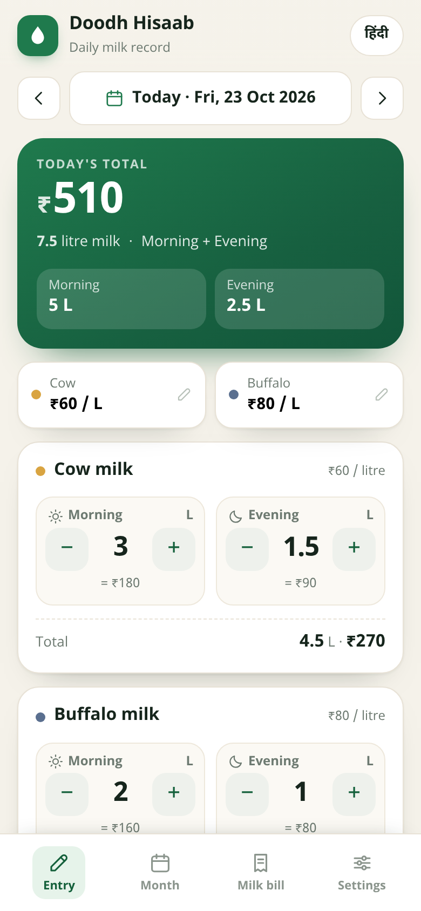
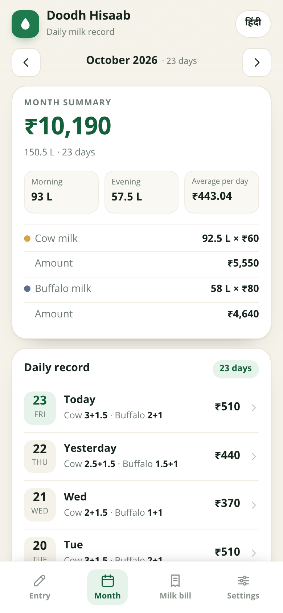
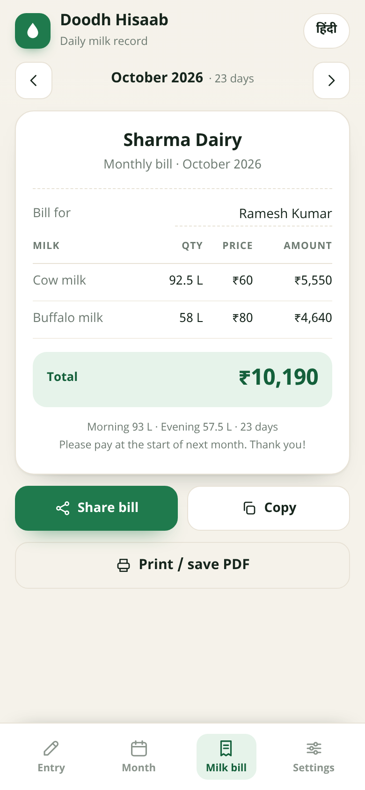

# 🥛 Doodh Hisaab — दूध हिसाब

A dead-simple milk record app for your phone. Note the milk you get **twice a day
(morning + evening)** for **two kinds of milk (cow + buffalo)** at a fixed price per
litre, and get the **monthly total and bill calculated automatically**.

> नाम: **दूध हिसाब** — सुबह-शाम का दूध और महीने का पूरा हिसाब, एक ही ऐप में।

<p align="center">
  
  
  
</p>

---

## 📲 Install the APK

**Download:** **[DoodhHisaab-latest.apk](https://github.com/yashasvamoond-commits/MILK-MAN-INVOICE/releases/download/apk-preview/DoodhHisaab-latest.apk)**

(All builds are listed on the [Releases page](https://github.com/yashasvamoond-commits/MILK-MAN-INVOICE/releases).)

1. Open the download link on your Android phone (Android 6.0 and newer).
2. Tap the downloaded file. Play Protect may warn because the app is not from the
   Play Store → tap **More details → Install anyway**.
3. Open **Doodh Hisaab**, set your price per litre once, and start adding milk.

The APK is built automatically from this repository by GitHub Actions
(workflow [`Build APK`](.github/workflows/build-apk.yml)) — every push runs the tests,
builds, verifies the signature and publishes the file.

---

## ✨ What it does

| Feature | Detail |
| --- | --- |
| Two milk types | Cow and buffalo (names can be renamed, e.g. "Desi cow") |
| Two times a day | Morning and evening, each with its own quantity |
| Fixed price per litre | Set once in onboarding, changed any time in Settings |
| Quick entry | `+` / `−` steps of 0.5 L, or tap the number to type an exact value |
| Daily total | Live ₹ amount for the day, split into morning/evening |
| Monthly total | Total litres, total amount, days recorded, average per day |
| Monthly bill | Clean bill with quantity × price per milk type and a grand total |
| Share / copy / print | Send the bill on WhatsApp or save it as a PDF |
| Price history | A price change starts from the current month — **old bills never change** |
| One-tap repeat | "Same as yesterday" copies the previous entry |
| Month browsing | Move between months and see every recorded day |
| Hindi + English | Full app in Hindi or English, switchable any time |
| Backup | Export a backup code and restore it on another phone |
| Offline & private | Works with no internet, no account, data stays on the phone |

---

## 🧮 How the monthly bill is calculated

For every day you record:

```
amount = (cow morning + cow evening) × cow price
       + (buffalo morning + buffalo evening) × buffalo price
```

At the end of the month the app adds every day together:

```
month total = Σ daily amounts      (shown in "Month")
bill total  = Σ (litres × price)   (shown in "Milk bill")
```

Example — cow ₹60/L, buffalo ₹80/L:

| Day | Cow (M + E) | Buffalo (M + E) | Amount |
| --- | --- | --- | --- |
| 1 | 2 + 1.5 = 3.5 L | 1 + 1 = 2 L | ₹210 + ₹160 = **₹370** |
| 2 | 3 + 1.5 = 4.5 L | 2 + 1 = 3 L | ₹270 + ₹240 = **₹510** |
| … | | | |
| **Month** | 92.5 L | 58 L | **₹10,190** |

If you raise the cow price from ₹60 to ₹70 in November, October's bill stays at ₹60 —
the app locks the price into each month when the first entry of that month is saved.

---

## 🗂 Project layout

```
web/                     The app itself (plain HTML/CSS/JS, no framework, no build step)
  index.html
  style.css              Mobile-first UI; static fallbacks for old WebViews
  core.js                Data model, storage format, month/bill calculations (UMD)
  app.js                 Screens & interaction
android/                 Thin native shell (one Activity + WebView)
  app/src/main/java/com/doodhhisaab/app/MainActivity.java
  app/src/main/AndroidManifest.xml
  app/src/main/res/…     Theme, icon, strings
  app/build.gradle       Ships /web as APK assets, minSdk 23, targetSdk 34
.github/workflows/build-apk.yml   Tests → build → verify → publish APK
tests/                   Node + jsdom tests (core maths and the real UI)
tools/                   Dev helpers: static server, icon generator, CSS fallbacks
docs/screenshots/        Screenshots used in this README
```

The Android app is a single `WebView` that loads `file:///android_asset/index.html`.
The only native additions are:

* storage in `SharedPreferences` (so data survives app restarts),
* the system share sheet for the bill,
* Android's print framework (bill → PDF),
* hardware back button support and a short vibration on each tap.

There is **no internet permission** in the manifest.

---

## 🛠 Development

```bash
npm install          # jsdom for UI tests
npm test             # 11 core tests + 16 UI tests
npm run serve        # http://localhost:8080 — open it in a phone-sized window
```

Build the APK locally (needs JDK 17 + Android SDK):

```bash
cd android
gradle assembleDebug
# → android/app/build/outputs/apk/debug/app-debug.apk
```

Or just push: GitHub Actions builds and publishes it for you.

### Editing the web app

`web/` is plain ES5-compatible JavaScript so it also runs on old Android WebViews.
After editing `web/style.css`, run `node tools/css-fallbacks.js` to refresh the
fallback declarations for browsers without CSS-variable support; icons can be
regenerated with `python3 tools/make_icons.py` (needs Pillow).

### Data format

Everything lives in a single JSON object:

```json
{
  "v": 1,
  "lang": "en",
  "onboarded": true,
  "rates": { "cow": 60, "buffalo": 80 },
  "monthRates": { "2026-10": { "cow": 60, "buffalo": 80 } },
  "entries": {
    "2026-10-23": { "cow": { "m": 2, "e": 1.5 }, "buffalo": { "m": 1, "e": 1 } }
  },
  "name": "Ramesh Kumar",
  "shop": "Sharma Dairy",
  "names": {}
}
```

Quantities are litres, prices are ₹ per litre. Settings → Backup shows/copies this
JSON, so you can move your records to a new phone at any time.
